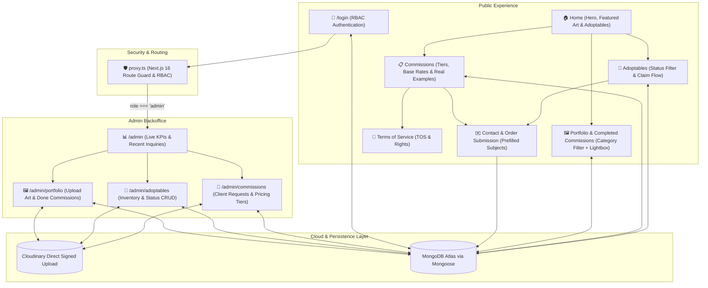

# 🎨 LucyArt — Digital Artist Platform & Marketplace

A modern, high-aesthetic web platform and management portal designed for digital artist **Lucy**. Built with **Next.js 16 (App Router)**, **React 19**, **TypeScript**, **Cloudinary**, and **MongoDB Atlas**, LucyArt serves as an international storefront, portfolio & completed commissions showcase, commission pricing guide, and adoptables character marketplace.

---

## 🌟 Vision & Project Concept

**LucyArt** is tailored for the independent digital creator economy, targeting an international, English-speaking audience. The platform features a signature dark cyberpunk / neon kawaii aesthetic (vibrant pinks, cyans, holographic shimmer cards, and playful typography) that reflects the artist's visual brand.

Unlike generic link-in-bio or static portfolio sites, LucyArt provides an integrated ecosystem bridging:
1. **Audience engagement & art discovery** (Interactive Portfolio & Completed Client Commissions showcase with high-res Lightbox).
2. **Transparent commission ordering** (Multi-tier pricing, real completed commission examples, clear deliverables, and integrated Terms of Service).
3. **Adoptable character sales** (Real-time status tracking: *Available*, *Pending*, *Sold*, and one-click claiming).
4. **Scalable Role-Based Authentication & Backoffice (`admin` / `client`)** (Protected `/admin` portal with signed `httpOnly` sessions, auto-bootstrapped Admin account, and ready-to-scale client accounts).

---

## 🧭 Core Flows & Architecture



### 1. Public Visitor Flows

- **Art & Completed Commissions Discovery (`/`, `/portfolio`)**: Visitors browse high-resolution digital illustrations filtered by category (*Full Body*, *Half Body*, *Bust*, *Chibi*, *Scene*, *Reference Sheet*) or specifically by **✨ Completed Commissions**. Clicking any card opens a high-resolution Lightbox modal with client credits and notes.
- **Commission Inquiry (`/commissions`, `/terms`)**: Potential clients review commission tiers (*Digital Sketch*, *Full Color Portrait*, *Full Body Scene*) with base USD pricing, feature lists, and real examples linked from finished commissions. Clicking **"Order this Tier"** navigates to `/contact` with the tier preselected.
- **Adoptables Marketplace (`/adoptables`)**: Collectors filter original character sheets by status (`available`, `pending`, `sold`). Clicking **"Claim"** directs the collector to `/contact` with the character name prefilled.
- **Inquiry & Order Submission (`/contact`)**: Powered by React 19 `useActionState` and Next.js Server Actions, storing requests directly in MongoDB Atlas for review in the Admin Panel.

### 2. Authentication & Role-Based Access Control (`/login` & `proxy.ts`)

- **Scalable User Model (`models/User.ts`)**: Supports `role: "admin" | "client"` and password hashing via Node.js native `crypto.scrypt` (`salt:hash`).
- **Auto-Bootstrap Admin**: On first login at `/login`, if no admin user exists in MongoDB Atlas yet and the credentials match `ADMIN_EMAIL` and `ADMIN_PASSWORD`, the system automatically provisions the Admin account in MongoDB.
- **Stateless Signed Sessions (`lib/session-token.ts` & `lib/auth.ts`)**: Uses Web Crypto API (`HMAC-SHA256`) stored in an `httpOnly` cookie (`lucyart_session`).
- **Defense-in-Depth Protection**:
  - **Next.js 16 `proxy.ts`**: Intercepts `/admin/:path*`, redirecting unauthenticated visitors to `/login` and restricting `client` roles from accessing `/admin`.
  - **Server Action Guards (`requireAdmin()`)**: Every mutation action and the `/api/cloudinary/sign` endpoint verify admin privileges on the server.

### 3. Admin & Business Management Flows (`/admin`)

- **Dashboard Overview (`/admin`)**: Real-time KPIs from MongoDB Atlas (Portfolio & Completed Commissions count, Active Adoptables, Pending Inquiries), environment health status indicators, and recent client requests.
- **Portfolio & Completed Commissions Manager (`/admin/portfolio`)**: Drag-and-drop uploader (`ImageUploader`) using signed direct uploads to **Cloudinary** (bypassing Vercel's 4.5MB serverless body limit). Artworks marked as **Completed Client Commissions** can optionally credit the client (`@ClientHandle`) and automatically link as visual examples to any Commission Tier.
- **Commissions & Requests Manager (`/admin/commissions`)**:
  - **Commission Types & Prices Tab**: Quick inline price & availability status toggles (`open` / `waitlist` / `closed`), visual portfolio artwork selector, and full tier editor.
  - **Client Requests Tab**: Manage incoming commission orders and adoptable claims (`pending` → `in_progress` → `completed` → `archived`).
- **Adoptable Inventory Control (`/admin/adoptables`)**: Full CRUD with Cloudinary character sheet uploads and one-click status toggles (`available` / `pending` / `sold`).
- **Social Links & Floating Discord Manager (`/admin/settings`)**: Edit social media footer icons/URLs, add or hide social platforms, and configure the floating Discord chat button (`url`, `@username`, label, and visibility) without touching code.

---

## 🛠️ Tech Stack & Infrastructure

| Technology | Purpose |
| :--- | :--- |
| **Next.js 16 (App Router)** | Fullstack React framework with Server Components, Server Actions, Route Handlers, and `proxy.ts` |
| **React 19** | Modern concurrent UI and `useActionState` form handling |
| **TypeScript 5** | Strict end-to-end typing across components, actions, and Mongoose models |
| **Tailwind CSS v4 & Custom CSS** | Design token system with CSS custom properties, holographic shimmers, and dark cyber-neon aesthetic |
| **MongoDB Atlas & Mongoose 9** | Cloud NoSQL document database (Free Tier M0 ready) with serverless connection pooling (`lib/mongodb.ts`) |
| **Cloudinary** | High-resolution artwork storage and CDN delivery via signed direct uploads (`lib/cloudinary.ts`) |
| **Vercel** | Serverless hosting and automatic CI/CD deployment |

---

## 📁 Project Structure

```
lucyart/
├── app/
│   ├── actions/                  # Next.js Server Actions
│   │   ├── adoptables.ts         # Adoptables CRUD & status updates (Admin-protected)
│   │   ├── auth.ts               # Login (with Admin bootstrap) & Logout actions
│   │   ├── commissions.ts        # Commission Tiers CRUD & Inquiries management
│   │   ├── contact.ts            # Public contact / order form handler
│   │   └── portfolio.ts          # Portfolio & completed commissions CRUD
│   ├── admin/                    # Protected Admin backoffice routes
│   │   ├── adoptables/page.tsx   # Adoptable inventory management
│   │   ├── commissions/page.tsx  # Commission requests & tier manager
│   │   ├── portfolio/page.tsx    # Portfolio & completed commissions uploader
│   │   ├── layout.tsx            # Admin layout with session verification & Logout
│   │   └── page.tsx              # Admin KPI dashboard
│   ├── api/
│   │   └── cloudinary/sign/      # Admin-protected POST endpoint for Cloudinary signatures
│   ├── adoptables/page.tsx       # Public adoptables catalog page
│   ├── commissions/page.tsx      # Commission tier pricing & examples
│   ├── contact/page.tsx          # Contact & commission order intake form
│   ├── login/page.tsx            # Authentication login portal
│   ├── portfolio/page.tsx        # Artwork & completed commissions gallery
│   ├── terms/page.tsx            # Comprehensive Terms of Service (TOS)
│   ├── globals.css               # Global CSS variables, animations & utilities
│   ├── layout.tsx                # Public root layout with header & footer
│   └── page.tsx                  # Public landing / hero page
├── components/
│   ├── AdminAdoptablesClient.tsx # Client UI for /admin/adoptables
│   ├── AdminCommissionsClient.tsx# Client UI for /admin/commissions
│   ├── AdminPortfolioClient.tsx  # Client UI for /admin/portfolio
│   ├── AdoptableCard.tsx         # Reusable adoptable card with Claim link
│   ├── AdoptablesCatalogClient.tsx # Interactive status filter for /adoptables
│   ├── ContactFormClient.tsx     # Interactive contact form with prefill support
│   ├── Footer.tsx                # Footer with social links & copyright notice
│   ├── ImageUploader.tsx         # Drag & drop direct Cloudinary uploader
│   ├── LoginFormClient.tsx       # Interactive login form component
│   ├── Navbar.tsx                # Main navigation bar
│   └── PortfolioGalleryClient.tsx# Interactive category filter & Lightbox modal
├── lib/
│   ├── auth.ts                   # Password hashing (scrypt), cookies & RBAC guards
│   ├── cloudinary.ts             # SHA-1 signature generator & asset deletion helper
│   ├── mongodb.ts                # Mongoose connection pooling helper
│   └── session-token.ts          # Edge-compatible HMAC-SHA256 session signer
├── models/
│   ├── Adoptable.ts              # Mongoose model for Adoptables
│   ├── CommissionTier.ts         # Mongoose model for Commission Pricing Tiers
│   ├── Inquiry.ts                # Mongoose model for Client Orders & Inquiries
│   ├── PortfolioItem.ts          # Mongoose model for Portfolio & Done Commissions
│   └── User.ts                   # Mongoose model for Users (Admin & Client roles)
├── types/
│   └── index.ts                  # Shared TypeScript interfaces
├── proxy.ts                      # Next.js 16 route protection & RBAC redirect proxy
├── .env.example                  # Template for environment variables
└── README.md                     # Project documentation
```

---

## 🚀 Getting Started & Deployment (MongoDB Atlas + Cloudinary + Vercel)

### 1. Environment Variables
Copy `.env.example` to `.env.local` in the root directory and fill in your credentials:

```env
# MongoDB Atlas (Free Tier M0)
MONGODB_URI=mongodb+srv://<username>:<password>@<cluster>.mongodb.net/lucyart?retryWrites=true&w=majority

# Cloudinary (API Keys from Dashboard)
NEXT_PUBLIC_CLOUDINARY_CLOUD_NAME=your_cloud_name
CLOUDINARY_API_KEY=your_api_key
CLOUDINARY_API_SECRET=your_api_secret

# Authentication & Initial Admin Bootstrap
AUTH_SECRET=replace_with_a_long_random_secret_string
ADMIN_EMAIL=admin@lucyart.com
ADMIN_PASSWORD=change_this_strong_password
```

### 2. Local Development

```bash
# Install dependencies
npm install

# Run development server
npm run dev
```

- Public Website: [http://localhost:3000](http://localhost:3000)
- Login Portal: [http://localhost:3000/login](http://localhost:3000/login)
- Admin Dashboard: [http://localhost:3000/admin](http://localhost:3000/admin)

### 3. Deploying to Vercel
1. Push the repository to GitHub / GitLab.
2. Import the project in [Vercel](https://vercel.com/new).
3. Add `MONGODB_URI`, `NEXT_PUBLIC_CLOUDINARY_CLOUD_NAME`, `CLOUDINARY_API_KEY`, `CLOUDINARY_API_SECRET`, `AUTH_SECRET`, `ADMIN_EMAIL`, and `ADMIN_PASSWORD` in **Vercel Project Settings → Environment Variables**.
4. In **MongoDB Atlas → Network Access**, allow access from anywhere (`0.0.0.0/0`) so Vercel serverless functions can connect.
5. Deploy and sign in at `/login` with your configured `ADMIN_EMAIL` and `ADMIN_PASSWORD`.
